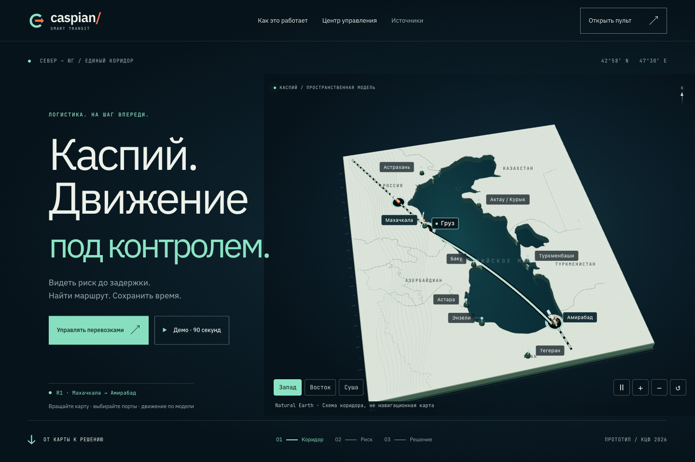

# 🚢 Smart Caspian Transit — предиктивный цифровой двойник мультимодального хаба

Прототип команды **Zaza international** на хакатон
IV Международного Каспийского цифрового форума (Каспийск, 13 ноября 2026).
**Кейс 2 «Smart Caspian Transit», трек 3 «Цифровая экосистема МТК “Север–Юг”».**

Разбор кейса по пунктам — в [`CASE-2.md`](CASE-2.md),
полный текст обоих кейсов — в [`docs/cases.md`](docs/cases.md),
оригинал файла — в [`cases/hackathon-cases-2026.docx`](cases/hackathon-cases-2026.docx).

> ⚠️ **Честно о прототипе.** Погода на море — **живая** (Open-Meteo,
> кэш 30 мин, офлайн — демо-фолбэк). Расстояния — haversine по координатам
> (оценка, не тарифные километражи). CO₂ — **проверенные факторы DESNZ 2026**
> (UK proxy, indicative для РФ/Иран/КЗ, без верификации). Ставки $/т-км —
> оценка (порядок величины Argus, окт 2025). Модель задержек — объяснимый
> скоринг; ML — **эксперимент на синтетических метках** (волна/ветер — из
> реального архива), метрики — synthetic benchmark, не точность на реальных
> рейсах. Загруженность портов и очереди на таможне — демо-снимок: живого
> открытого фида для них нет. События грузов — демо-симуляция или ручной
> ввод, **не GPS/AIS-трекинг**. Цифровой коридор подписывает внутреннюю
> оценку документов Ed25519 и связывает записи хешами в SQLite;
> это **не DLT/блокчейн и не таможенное разрешение**.

## Новый центр управления



Главная сохраняет выбранный Freight Services Hero: локальный клип перегрузки контейнера, прокручиваемую ленту возможностей и интерактивный атлас Каспия. Рабочая платформа находится отдельно по `/app`: обзор, реестр перевозок, паспорта грузов, карта, риски и задачи, документы, аналитика. Каждая страница открывается напрямую, без прокрутки презентации. Береговая линия Natural Earth 1:50m, Three.js r180 и GSAP 3.15.1 хранятся локально. Есть управление клавиатурой, пауза, reduced motion и SVG при отсутствии WebGL.

- Реестр поддерживает поиск, фильтр риска и сортировку. Ссылка на паспорт сохраняет выбранную вкладку, работает при обновлении страницы и через «Назад».
- Обзор собирает предупреждения, документы и ближайшие задачи по всем перевозкам. Из предупреждения можно открыть нужную вкладку или создать задачу с заполненными грузом и причиной.
- Задачи имеют ответственного, срок, приоритет, статус и заметку. Они хранятся в SQLite; устаревшая версия не может перезаписать чужие изменения. Завершение задачи не скрывает оставшийся риск груза.
- Карта переключается между **3D и 2D**, сохраняя маршрут и состояние. Обычная карта поддерживает масштабирование, перемещение, порты и возврат к маршруту; география локальная, внешние тайлы не нужны.
- Очередь документов и аналитика работают со всем портфелем. Аналитика считает остаток расходов и CO₂e по текущим планам; это не выручка или подтверждённая экономия.

- Карточка груза связана с текущим узлом, принятым планом, экономикой, документами и фактическими событиями.
- Горизонт 72 часа показывает сценарное положение и предстоящие риски. Прогноз Open-Meteo загружается в фоне; отсутствие данных отмечено в интерфейсе.
- Альтернативы начинаются от текущего узла. Новый план сохраняется с версией, снимком расчёта и событием решения; завершённые плечи остаются в истории. Идемпотентный запрос и проверка версии защищают от повторного или устаревшего подтверждения.
- Полная стоимость включает перевозку, простой, штраф за опоздание и перегрузку. Дедлайн и ставки редактируются. Исходные ставки учебные.
- Паспорт принимает TXT, текстовый PDF, PNG/JPEG до 2 МиБ. Сверяются номер груза, масса, назначение и описание. Изображения распознаёт локальный Tesseract при наличии; без него остаётся явный статус ручной проверки. Оригиналы хранятся в приватной SQLite, а не в static. Сканированные PDF без текстового слоя требуют ручной проверки или загрузки страницы изображением.
- «Стыковки» показывает, как закрытие погрузки превращает час опоздания в потерю рейса. Сравниваются исходная очередь и её сокращение при одинаковой задержке подвоза; 1 024 сценарных прогона показывают остаточный риск. Расписание задаётся для сценария и не выдаётся за фид перевозчика.
- Приоритет маршрута можно выбрать по времени, расходам, CO₂e или устойчивости к нескольким стресс-сценариям. Для показанных кандидатов отмечается Парето. Просмотр не меняет действующий план.
- В «Документах» цифровой коридор выпускает квитанцию Ed25519, связанную с файлами и версией маршрута. Можно проверить подмену, увидеть устаревшую оценку и скачать квитанцию с отдельным открытым ключом для независимой проверки.
- Демо на 90 секунд проходит рабочую историю, поддерживает паузу, шаги и выход; само не принимает решения за оператора.

Исходная аналитика сохранена по `/static/laboratory.html`. Её модельные и экспериментальные результаты имеют прежние ограничения. Офлайн-кэш сохраняет интерфейс и карту; данные перевозок и API не кэшируются.

Дизайн: [направление](docs/design/DIRECTION.md), [система](docs/design/MASTER.md), [скиллы и источники](docs/SKILL_SOURCES.md), [проверки](docs/design/QA.md). Все использованные сервисы и ассеты не потребовали оплаты. MotionSites использован в пределах бесплатных запросов; использован готовый бесплатный клип Freight Services Hero, платная генерация видео не запускалась.

[Как работает сайт](docs/HOW_IT_WORKS_RU.md) · [Сценарий защиты на 5 минут](docs/HACKATHON_DEMO.md) · [Файлы для демонстрации](docs/demo-kit/README.md) · [Проверки новой версии](docs/HACKATHON_QA.md).

Многостраничный продукт: [пользовательские сценарии и адреса](docs/PRODUCT_WORKSPACE.md),
[API портфеля и задач](docs/WORKSPACE_API.md), [проверки продукта](docs/PRODUCT_QA.md).

## Идея

**Проблема (из кейса).** МТК «Север–Юг» — артерия Россия–Иран–Индия.
Каспий — критический узел, а главная боль — рассинхронизация ж/д,
морского и автотранспорта, простои на таможне и непредсказуемая
погода: графики срываются, а узнают об этом постфактум.

**Решение.** Единое окно логиста с цифровым двойником груза:
прогноз задержки каждого плеча маршрута *до* отправки, таможенный
pre-clearance до прибытия груза и альтернативные маршруты при
форс-мажоре — в один клик.

**Для кого.** Логисты и экспедиторы коридора, администрации портов
(Астрахань, Махачкала, Актау/Курык, Баку, Амирабад, Энзели), таможня,
грузоотправители.

**Чем отличаемся.** Прогноз не «чёрный ящик»: каждая задержанная
часовая единица подписана причиной («волна 1,2 м → +3,6 ч»,
«Актау загружен на 71% → +8,5 ч»). А форс-мажор — это кнопка:
«Шторм на Каспии» пересчитывает все маршруты, и сухопутный через
Баку становится лучшим — прямо на глазах жюри.

## Что внутри (MVP — все 3 требования кейса)

1. **Предиктивная модель** — скоринг задержек по погоде на Каспии,
   загруженности портов и таможенным очередям; узкое место подсвечено,
   стыковка ж/д ↔ паром считается явно. Лаборатория использует время
   закрытия погрузки и дискретные окна отправления; пропуск окна переносит
   рейс на интервал (обычно 72 ч, допущение). Погодное ограничение до
   +48 ч при волне ≥ 2 м — отдельное сценарное правило. ML даёт
   экспериментальный прогноз с калиброванным интервалом и журналом факта.
2. **Цифровой коридор / pre-clearance** — сверка загруженных документов
   и подписанная Ed25519 оценка, привязанная к версии маршрута, хешам
   файлов и цепочке квитанций. Запись защищается ключом оператора,
   идемпотентностью и проверкой актуальности. Подпись можно проверить
   офлайн. Правила внутренние; официального таможенного выпуска нет.
3. **Единое окно логиста** — карта коридора, двойник груза (таймлайн
   план/прогноз + фактические события), углеродный след маршрута
   (CO₂e, ESG), сравнение 3 маршрутов по времени, риску, CO₂ и
   стоимости, динамический поиск по графу, лента исключений.

## Маршруты (Москва → Бендер-Аббас)

| Маршрут | Путь | База (ход) |
|---|---|---|
| R1 Западный | Москва → Махачкала → паром → Амирабад → Бендер-Аббас | **122 ч** (40+50+32) |
| R2 Восточный | Москва → Астрахань → паром → Актау/Курык → Бендер-Аббас | **108 ч** (30+26+52) |
| R3 Сухопутный | Москва → Баку → Астара → Бендер-Аббас (без моря) | **94 ч** (52+6+36) |

**Время в пути = ход + ожидание парома + задержки.** Ожидание —
допущение: interval/2 = 36 ч на каждое морское плечо (фиксированного
расписания у каспийских паромов нет). Monte Carlo сэмплирует ожидание
из Uniform(0, 72).

**Условные плечи** (маркированы `conditional=true` в API и UI):
Махачкала–Амирабад и Махачкала–Энзели (регулярные линии не подтверждены —
тесты/анонсы, см. `docs/RESEARCH.md`), Актау–Бендер-Аббас (ж/д KTI через
Казахстан–Туркменистан–Иран, маршрут абстрактный). Актау в графе —
паромный терминал **Курык** (порт Актау не принимает паромы с 2018).

## Стек

Python 3.12 + FastAPI + Uvicorn, scikit-learn/numpy (ML), SQLite (WAL)
для runtime-состояния. Статический фронт (HTML/CSS/JS, Three.js + GSAP, Leaflet в аналитике и шрифты
IBM Plex Sans / JetBrains Mono вендорены локально — без npm, без сборки
и без CDN). Текущий дизайн — `docs/design/MASTER.md`; прежний контракт аналитики — `docs/DESIGN_CONTRACT.md`.
PWA (service worker, manifest, офлайн-режим). Docker (non-root, volume, healthcheck).

## Запуск

```bash
./run.sh                 # http://localhost:8000 — нужен Python 3.12
                         # (пины scikit-learn/numpy проверены на 3.12)
# или
docker compose up        # http://localhost:8000, volume sct-data-v2,
                         # non-root, healthcheck /api/health

# тесты (герметичные; без optional DLT-зависимостей anchor-тесты пропускаются)
cd backend && python -m pytest -q

# сброс пользовательского демо-состояния (seed-грузы остаются)
curl -X POST localhost:8000/api/demo/reset
# или: python3 scripts/reset_demo_data.py
```

API-документация: http://localhost:8000/docs

Для браузерных проверок (отдельный временный сервер и база, демо не сбрасывается):

```bash
python3 -m venv .venv
.venv/bin/pip install -r backend/requirements.txt
npm ci
npx playwright install chromium
npm run test:ui
npm run test:ml-ui
npm run test:hackathon-ui
npm run test:product-ui
npm run test:maps-ui
# macOS с установленным Chrome: PW_CHANNEL=chrome npm run test:ui
# другое окружение Python: PYTHON=/absolute/path/to/python npm run test:ui
```

Результаты и снимки появляются в `artifacts/qa/`; это локальные проверочные артефакты. npm нужен только для браузерных тестов, сборки frontend нет.


### Эксплуатация (важно для деплоя)

- Runtime-состояние — SQLite в `backend/app/data/sct.db` (в Docker — volume).
  Сервер работает от non-root (uid 1000). Образ стартует через
  `backend/entrypoint.sh`: если контейнер запущен от root, entrypoint делает
  `chown` каталога данных на appuser и сбрасывает привилегии (`setpriv`) —
  это чинит том, созданный root'ом старого образа, без доступа к серверу
  (паттерн postgres/mysql: от root работает только короткий entrypoint,
  сам uvicorn — от appuser). Если контейнер запущен сразу от non-root,
  entrypoint просто exec'ает сервер.
  **Если том всё же недоступен на запись**, приложение честно
  покажет `store.ok=false`/`fallback:true` в `/api/health` и временно перейдёт
  на fallback `/tmp/sct-data` (персистентность при пересоздании контейнера не
  гарантируется). Запасной фикс на сервере:
  ```bash
  docker exec -u root <container> chown -R 1000:1000 /app/backend/app/data
  docker restart <container>
  ```
  Локальный `docker compose up` использует том `sct-data-v2` (создаётся из
  каталога образа, принадлежащего appuser, поэтому доступен на запись).
- Образ включает DLT-зависимости (`requirements-dlt.txt`: web3 + eth-tester[py-evm]),
  поэтому DLT-якорь реестра работает live на локальном EVM devnet (не mainnet).
  Без этих пакетов приложение работает, якорь честно деградирует до hash-chain.
- `/api/health` показывает статус store (ok/degraded, путь, ошибка) —
  используйте для мониторинга после деплоя.
- Каталог данных можно переопределить: `SCT_DATA_DIR=/path/to/writable`.
- Закрытый ключ квитанций `corridor-issuer.ed25519` создаётся при первом
  явном выпуске в каталоге данных с правами 0600. Сохраняйте его вместе
  с базой между перезапусками. Он не входит в Git и не отправляется
  клиенту. Публичный ключ доступен отдельно через API.

Переменные окружения: `SCT_HOST` (локальный запуск, по умолчанию 127.0.0.1),
`SCT_WRITE_TOKEN` (опциональный токен записи,
заголовок `X-Write-Token`; без него демо-режим открыт и маркирован),
`SCT_WRITE_RATE_LIMIT` (записей/мин/IP, по умолчанию 60),
`SCT_MAX_BODY_BYTES` (лимит тела, по умолчанию 32 КБ),
`SCT_ML_HISTORY_CSV` (CSV реальных историй для ML, см.
`docs/ML_DATA_CONTRACT.md`).

## Реальные данные (проверено 12 ноября 2026)

- **Погода — живая**: Open-Meteo marine API (волна) + forecast API
  (ветер), без ключа, кэш 30 мин, офлайн — демо-фолбэк. Лицензия
  CC BY 4.0 (атрибуция обязательна), free tier — только non-commercial.
  Архив 90 дней — `backend/app/archive_weather.json`
  (север: волна средняя 0,45 м, макс 1,24; запад: средняя 0,71 м,
  p90 1,44, макс 2,52; волна ≥ 2 м — 2,3% часов на западе, 0% на севере).
  Сэмплы прорежены (каждый 6-й час, 364 точки/сегмент); статистики в
  метаданных посчитаны по **полному** архиву (2184 ч).
- **Расстояния** — haversine по координатам ×1,1 (море): Махачкала–Амирабад
  844 км по прямой (в v0.1 ошибочно было 540 — исправлено),
  Астрахань–Актау 387 км. Ж/д/авто — оценки, не тарифные километражи.
- **Паромы без расписания**: рейс Баку–Туркменбаши ~17 ч, Курык–Баку
  <24 ч, ожидание 1–2 дня — норма, до недели при заторах (Caravanistan,
  Wikivoyage, снапшот ships.asco.az). Поэтому интервал отправления в
  модели — 72 ч, ожидание — interval/2 (допущение), пропуск рейса +48 ч.
- **Коридор**: 21,5 млн т в 2025; янв–сен 2026 — 8,9 млн т ж/д (+9,6%),
  транскаспийский +19,3%; прогноз 32 млн т к 2030; доставка 15–20 дней
  вместо 35–45 через Суэц. Порт Махачкала: 3,5 млн т в 2025,
  янв–авг 2026 — 2,9 млн т (+42,5%), мощность ~10–11 млн т к 2030.
  Источники: Правительство РФ / РЖД / Росморречфлот через прессу (окт 2026).
- **CO₂ — проверенные факторы DESNZ 2026** (flat file v1.2 от 31.07.2026,
  WTW, г CO₂e/т-км): ж/д **25,83** (строка 27_315_3151_14_1), паром RoRo
  **51,58** (27_320_3239_14_1), авто (articulated HGV) **122,92**
  (27_304_3128_14_1). Ранее использовавшиеся 32,74/63,28/97,49 не найдены
  ни в одном издании DESNZ 2023–2026 и удалены. Формулировка: «оценка по
  методологии, согласованной с ISO 14083 / GLEC v3.3, **без верификации**»;
  UK proxy — indicative для РФ/Иран/КЗ; хабы, перегрузки и холостые
  пробеги не учтены. Единицы итогов — kg CO₂e.
- **Ставки $/т-км — оценка** (ж/д 0,04 · море 0,045 · авто 0,12): порядок
  величины согласуется с Argus Caspian Transport (окт 2025: Актау–иранские
  порты $40–45/т, Астрахань–иранские $63–65/т); точная калибровка по парам
  портов не выполнена.

## Возможности

- **Динамический поиск маршрутов** — граф коридора (**11 узлов,
  17 рёбер**, включая подключённый Энзели): Dijkstra + Yen k=3
  (стабилен на равных весах). Парето-метка — эвристика **среди найденных
  k кандидатов** по времени/стоимости/CO₂, не глобальная оптимизация.
  Веса рёбер — живой прогноз, сценарии меняют оптимальный маршрут.
- **Вероятностный ETA** — Monte Carlo (200 прогонов, seed 7): P50/P90/P95
  и P(задержка > 24 ч). Волна/ветер — bootstrap из реального архива,
  ожидание парома — Uniform(0, 72), загруженность/таможня — синтетические
  распределения вокруг демо-снимка. Это **квантили симуляции**, не
  эмпирическая вероятность и не гарантия доставки.
- **Единый сценарный движок** — явная волна/ветер > шторм > live/fallback;
  применяется одинаково в forecast/compare/search/exceptions/shipments/
  timeline/ML/Monte Carlo. Параметры: `close`, `extra_customs_h`,
  `wave_m`, `wind_ms`. Индекс риска — эвристика delay/(delay+18)
  (пол 0,85 для морских маршрутов в шторм), не эмпирическая вероятность.
- **Цифровой двойник** — таймлайн = модель (план/прогноз по каждому плечу)
  + фактические события (таблица `events`, DCSA T&T-подобная модель:
  departure/arrival/gate_in/gate_out/load/discharge/customs_*/delay/note).
  Демо-события seed-грузов маркированы `demo-simulation` — не телеметрия.
  Лента исключений с рекомендованными действиями.
- **Цифровой коридор в пульте** — проверка файлов, оценка, подпись,
  локальная цепочка и отдельная проверка актуальности; [описание](docs/DIGITAL_CORRIDOR.md).
  Устаревшая оценка сохраняет криптографически действительную подпись.
- **Прежний pre-clearance в лаборатории** — реестр документов в SQLite (персистентный): статусы
  missing/submitted/verified/rejected/expired/unknown назначает сервер
  («SCT Demo Customs Authority», симуляция): непустая ссылка → verified,
  `REJ-` → отказ, `EXP-` → истёк. Ledger v2: hash покрывает
  decision + doc_hash + rule_version + issuer, снимок документов хранится
  в записи. Tamper-evident демо-механика, не DLT.
- **Provenance** — `GET /api/provenance`: 11 источников, каждый маркирован
  kind (live/historical/demo/synthetic/static/assumption), с лицензией
  и оговорками.
- **Persistence** — SQLite WAL (`store.py`): транзакции (BEGIN IMMEDIATE),
  монотонные ID (counter, не переиспользуются), идемпотентность
  (`Idempotency-Key`), миграция legacy JSON, concurrent-safe запись,
  атомарное добавление в hash-chain. Docker volume `sct-data-v2`.
- **Безопасность** — escaping всех динамических вставок в UI (XSS закрыт),
  валидация диапазонов (волна 0–15 м, ветер 0–60 м/с, таможня 0–168 ч,
  вес 0–5000 т, неизвестные узлы → 422), опциональный `SCT_WRITE_TOKEN`,
  rate limit записей 60/мин/IP, лимит тела 32 КБ.
- **PWA** — service worker (network-first навигация, версионированный
  кэш, offline fallback), иконки 192/512, полный manifest, офлайн-баннер,
  быстрая навигация, mobile CSS (touch targets 44px). Leaflet вендорен
  локально; тайлы OSM — по сети (без интернета карта без тайлов).

## ML — эксперимент, честно

- **В пульте:** вкладка «ML-прогноз» показывает задержку оставшегося
  принятого маршрута, интервал, факторы, выход за опыт модели и
  сравнение альтернатив. Сценарии волнения и таможни работают как
  предварительный просмотр; они не изменяют принятый план.
- **Модель:** выбор между RandomForest, HistGradientBoosting, их смесью
  и простыми базовыми моделями на отдельной валидации. Обучение,
  выбор модели, калибровка интервала и финальная проверка используют
  раздельные части данных. Обучение ленивое и воспроизводимое.
- **Неопределённость:** калиброванный интервал задержки с номинальным
  покрытием 90%, измеренные покрытие и ширина на отложенной выборке.
  При нетипичных условиях показаны причины и оперативный расчёт.
  Интервал не является вероятностью своевременной доставки.
- **Данные:** волна/ветер — bootstrap из реального 90-дневного архива
  Open-Meteo; метки задержек — **синтетические** (правила коридора +
  шум). Качество воспроизведения генератора **не означает точность
  прогноза реальных рейсов**.
- **Проверка:** `GET /api/ml/info` публикует MAE/RMSE/R² моделей,
  разбиение, метрики интервала, версии и хеши. Некорректная заданная
  история отключает ML с объяснением; она не подменяется синтетикой.
- **История:** кнопка сохранения прогноза фиксирует признаки и версию
  до исхода. Журнал сопоставляет прогноз с фактическим прибытием;
  демо-грузы, смена маршрута и невалидные события исключаются.
  CSV для следующего обучения содержит время прогноза и получения
  результата. Автоматического дообучения на кликах нет.
- **API:** `/api/operations/{id}/intelligence`, `/api/ml/info`,
  `/api/ml/forecast`, `/api/ml/shipment/{id}`; журнал —
  `/api/operations/{id}/intelligence/snapshots`.
- [Как пользоваться сайтом](docs/HOW_IT_WORKS_RU.md),
  [ML-методология](docs/ML_METHODOLOGY.md),
  [контракт истории](docs/ML_DATA_CONTRACT.md),
  [журнал качества](docs/ML_JOURNAL.md).

## API

- `GET /api/health`, `/api/nodes`, `/api/ports`, `/api/weather`,
  `/api/weather/live` (живая погода), `/api/corridor` (статистика)
- `GET /api/graph` — узлы и рёбра графа
- `GET /api/routes`, `/api/routes/{id}/forecast`,
  `/api/routes/search?from_node&to_node&objective&k` — динамический поиск
- `GET /api/compare` — сравнение маршрутов (+ P50/P90 симуляции)
- `GET /api/shipments`, `POST /api/shipments` (создание груза,
  `Idempotency-Key`), `/api/shipments/{id}`,
  `/api/shipments/{id}/timeline`, `POST /api/shipments/{id}/events`
  (фактические события, `source` обязателен), `/api/exceptions`
- `POST /api/clearance/submit` (клиент подаёт ссылки, статусы — сервер),
  `GET /api/clearance/ledger`, `GET /api/clearance/documents/{id}`
- `GET /api/provenance` — 11 источников с kind и лицензиями
- `POST /api/demo/reset` — сброс runtime-состояния
- `GET /api/ml/info`, `/api/ml/forecast`, `/api/ml/shipment/{id}`
- `GET /api/operations/{id}/resilience` — стыковка и сравнение маршрутов
- `GET /api/operations/{id}/corridor`, `/api/operations/corridor/issuer`
- `POST /api/operations/{id}/corridor/issue`, `.../corridor/verify`
- `GET /api/operations/{id}/corridor/receipts/{receipt_id}?download=true`

Прогнозные эндпоинты принимают сценарий: `storm`, `close`,
`extra_customs_h`, `wave_m`, `wind_ms`. Записи защищены опциональным
токеном (`X-Write-Token`) и rate limit; без токена — открытый демо-режим.

## Структура

```
.
├── CASE-2.md                  # разбор кейса №2 по пунктам
├── README.md                  # этот файл
├── cases/hackathon-cases-2026.docx   # оригинал файла кейсов
├── run.sh / Dockerfile / docker-compose.yml / .dockerignore
├── scripts/
│   ├── fetch_weather_archive.py      # обновление 90-дневного архива погоды
│   ├── reset_demo_data.py            # сброс демо-состояния (SQLite)
│   └── ml_history_template.csv       # шаблон CSV реальных историй для ML
├── backend/
│   ├── requirements.txt
│   ├── app/
│   │   ├── main.py            # FastAPI: API, валидация, защита записей
│   │   ├── data.py            # узлы, граф, маршруты, seed-грузы, факторы
│   │   ├── model.py           # скоринг, Monte Carlo, сценарии, таймлайн,
│   │   │                      # исключения, pre-clearance, provenance
│   │   ├── graph.py           # Dijkstra + Yen k-shortest + Парето (эвристика)
│   │   ├── ml.py              # ансамбль RF+HGB, CSV-контракт, атрибуция
│   │   ├── weather.py         # Open-Meteo live (кэш 30 мин) + архив
│   │   ├── store.py           # SQLite WAL: грузы, реестр, документы, события
│   │   ├── archive_weather.json
│   │   ├── data/              # sct.db (runtime, в .gitignore)
│   │   └── static/            # index.html, styles.css, app.js, sw.js,
│   │       │                  # manifest.json, иконки 192/512 (PWA)
│   │       └── vendor/        # Leaflet + fonts.css/woff2 локально
│   └── tests/                 # api, routing, scenarios, clearance, resilience,
│                              # store, security, ml, events, co2, weather,
│                              # docking, ports_live, anchor, manhattan
└── docs/
    ├── cases.md               # транскрипция обоих кейсов
    ├── RESEARCH.md            # верифицированное исследование источников
    ├── DATA_SOURCES.md        # источники данных и их качество
    ├── ARCHITECTURE.md        # архитектура и решения
    ├── DESIGN_CONTRACT.md     # дизайн-контракт редизайна «Caspian Ops»
    ├── ML_METHODOLOGY.md      # ML: данные, метрики, объяснимость
    ├── ML_DATA_CONTRACT.md    # CSV-контракт реальных историй
    ├── ENGINEERING_LOG.md     # журнал итераций и циклов улучшений
    ├── DEMO_RUNBOOK.md        # сценарий демо и запасные варианты
    ├── PITCH.md               # питч на 3 минуты + вопросы жюри
    ├── PLAN.md                # план команды на хакатон
    └── ROADMAP.md             # план развития после хакатона
```

## Честные ограничения

- Нет открытого live-фида загруженности портов и таможенных очередей —
  демо-снимок (`data.py`); нет открытой истории реальных задержек —
  ML-метки синтетические.
- Регулярные линии Махачкала–Амирабад/Энзели не подтверждены — плечи
  условные; ж/д плечо Актау–Бендер-Аббас (KTI) абстрактно.
- CO₂ — оценка по DESNZ 2026 (UK proxy), без верификации, без хабовых
  операций; стоимость — оценка по ставкам $/т-км.
- Индекс риска и P50/P90/P95 — эвристика и квантили симуляции, не
  эмпирические вероятности и не гарантии.
- Реестр — локальная цепочка с подписями, не DLT; доверие к издателю
  требует отдельно полученного открытого ключа. События — не GPS/AIS.
- Open-Meteo free tier — non-commercial; для коммерческого продукта
  нужна подписка (данные CC BY 4.0, атрибуция обязательна).
- Один процесс + SQLite: для пилота с несколькими writers нужен
  внешний storage и RBAC (см. `docs/ROADMAP.md`).
